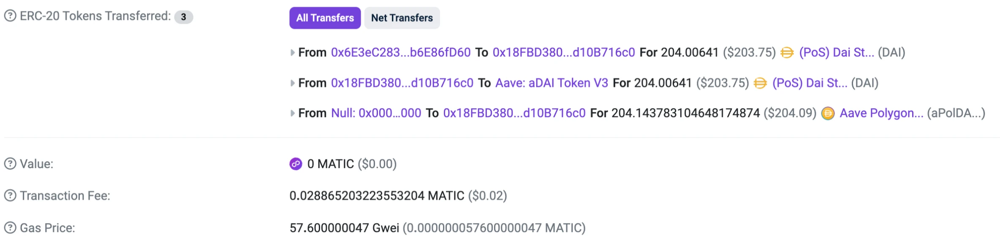

2024 年 3 月 20 日，我遭遇了一次数据库勒索。数据库被清空，对方留下了一段英文消息，声称已经备份全部数据，要求在 48 小时内支付 0.0117 枚比特币，否则将公开并删除数据。

按照当时的币价粗略换算，这笔赎金约为 5,500 元人民币。至于对方是否真的保留了可恢复的数据，仅凭留言无法确认。

这段经历引出了一个问题：对方为什么指定比特币收款？一个没有银行负责记账的系统，又如何确认这笔钱究竟属于谁？

理解这些问题，可以从私钥和账本开始，再逐步走到共识、智能合约，以及去中心化的边界。

## 一、从一封勒索信说起

比特币允许参与者通过网络发起价值转移，转账过程无需逐笔获得某一家银行的批准。跨地域转移的便利，以及地址与现实身份之间并不直接对应的特点，使它也成为部分勒索者索要赎金的工具。

但比特币的交易记录公开可查。地址虽然通常不直接显示姓名，却可能通过交易关联、交易所记录或其他信息与现实身份联系起来。因此，使用比特币不能等同于完全匿名，更不意味着资金流向无法追踪。

从这次勒索经历切入，是因为一笔收款要求，恰好触及了区块链最基本的能力：在参与者彼此不认识、缺少统一记账机构的情况下，维护一份能够验证的资产记录。

传统银行由银行及其相关清算体系维护账户和转账记录。比特币则把验证记录的能力交给运行相应软件的节点，并通过协议协调哪些记录进入共同接受的历史。

两者都需要规则。区别在于规则由谁执行，以及参与者能够独立验证到什么程度。

## 二、私钥控制的究竟是什么

“我有一枚比特币”，很容易让人联想到钱包里放着一枚硬币。实际使用中，钱包主要帮助用户管理密钥、查询链上记录，以及构造和签署交易。

比特币采用未花费交易输出，也就是 UTXO 模型。可以把它理解为：历史交易留下了一些尚未使用的输出，每一项输出都规定了后续花费它需要满足的条件。钱包将自己能够控制的输出汇总，显示为余额。

当用户转账时，钱包选择可花费的输出，创建新的交易输出，并通过私钥生成签名。节点依据相应条件验证签名和交易，确认这笔支出是否获得授权，是否试图重复花费已经用掉的输出。

私钥因此具有直接的支配意义。对于常见的自托管钱包，掌握私钥或助记词的人，通常就能够授权转移对应资产。钱包软件可以重新安装，但丢失密钥后，通常没有一个中心客服能够替用户重置支配权。

这里还需要区分自托管钱包与交易所账户。如果资产存放在中心化交易所，用户看到的余额通常是平台内部账本中的记录，链上私钥由平台管理。用户能否提币，还依赖平台的实际资产、服务状态和提币规则。

因此，“资产在链上”和“用户自己控制私钥”是两件需要分别确认的事。使用区块链应用时，首先值得问的就是：谁真正有权签署这笔资产转移？

## 三、陌生节点如何维护同一本账

如果只是把账本复制到很多服务器，仍然无法解决一个关键问题：当不同节点收到相互冲突的交易时，应当接受哪一份历史？

以比特币为例，一笔交易通常会经历以下过程：

1. 钱包构造并签署交易，将它提交给网络中的节点。
2. 节点检查交易是否符合规则，符合转发条件时再传播给其他节点。
3. 矿工从候选交易中组织区块，并进行工作量证明计算。
4. 其他节点独立验证新区块及其中的交易，再依据共识规则更新本地账本。

矿工与验证节点的职责并不相同。矿工竞争产生新区块，验证节点检查区块是否满足自己执行的协议规则。一个区块即使包含大量计算工作，只要违反规则，遵守规则的节点仍会拒绝它。

当网络短暂出现不同分支时，比特币节点会在符合规则的候选链中，依据累计工作量选择接受的链。这与“多数服务器举手投票”有明显区别。简单增加服务器数量，并不会自动获得相应的共识权重。

一笔交易进入区块后，称为获得确认。后面继续接上新区块，会增加改写这段历史所需的工作量。比特币的确认具有概率性，业务系统通常根据金额和风险要求设置确认数，确认越多，因链重组而改变记录的风险通常越低。

对于无效交易，节点会拒绝将其作为有效交易接受。对于有效区块之间的分支切换，则可能发生链重组，需要重新判断部分交易的确认状态。这些情形不能统一描述为“多数节点否认后，所有操作就像从未发生”。

### 挖矿的收益从哪里来

矿工产生有效区块后，可以通过区块中的特殊交易领取区块补贴，以及该区块所包含交易的手续费。

区块补贴来自协议规定的发行机制。比特币的初始区块补贴为 50 BTC，并按每 210,000 个区块减半的规则递减。节点会检查领取的金额是否超过允许范围，超额领取会导致区块无效。

这套机制同时处理了发行和激励问题。矿工承担设备、电力与机会成本，协议让符合条件的区块获得收益。手续费则由交易的输入总额与输出总额之差形成，矿工通常会结合手续费水平和区块容量决定收录哪些交易。

以上描述针对比特币的工作量证明。不同区块链可以采用不同机制，例如以太坊目前使用权益证明，不能把“挖矿”当作所有区块链统一的运行方式。

## 四、智能合约如何执行规则

比特币已经展示了如何维护可验证的交易历史。以太坊等平台进一步提供了通用程序的执行环境，使应用可以把部分业务规则放到链上执行。

智能合约是在链上特定地址部署的程序，包含代码和状态。用户提交交易调用它的功能，网络按照规则执行，再将结果纳入链上状态。

从软件工程角度看，需要区分几种东西：白皮书用于说明设计，协议规定系统如何运行，节点软件实现这些规则，智能合约则是部署在相应链上执行的程序。它们彼此关联，但不能混用。

代币合约就是一个常见例子。它可以记录各地址的余额，处理转移和授权。谁可以增发、是否能够暂停、是否存在冻结地址的权限，都取决于具体实现及其管理机制。

### 一笔交易为什么会出现多条转移记录

原分享中有一张 Polygon 链上交易的截图：一次合约调用，页面列出了三条代币转移事件。

*图片摘自原分享 PPT，保留代币转移与手续费区域。截图中的 MATIC 名称及美元估值为当时页面显示。*

截图中，同一笔交易涉及 DAI 的多次转移，并出现了一条从零地址开始的 aToken 转移事件。这说明一次业务操作可能触发多个合约调用和状态变化，区块浏览器再将相关事件展示为多条记录。

页面上的代币转移记录与网络手续费需要分别看待。手续费单独列在交易费用字段中，不能把第三条转移记录直接认作矿工费。截图展示的具体代币数量也不应在不了解合约精度和兑换规则时，直接当作等额关系解释。

这些记录来自合约事件。事件便于钱包、浏览器和索引服务展示执行结果，但进一步核实一笔业务操作，仍需要结合合约地址、代码和实际状态。

### 铸造、销毁与零地址

在 ERC-20 代币中，铸造通常意味着增加总供应量，并增加某个地址的余额。ERC-20 标准建议，创建代币时发出来源为零地址的 `Transfer` 事件，方便外部系统识别。

常见实现也会在销毁时减少总供应量，并发出目标为零地址的事件。例如 OpenZeppelin 的实现，就明确区分了普通转移、铸造和销毁时对余额及总供应量的处理。

零地址在这里承担特殊标记的作用，不能仅凭页面显示就推断发生了供应量变化。某些操作只是把资产送到难以使用的地址，是否真正减少了合约记录的总供应量，还需要查看具体逻辑。

同样，部署一个代币合约，只能说明某套记账与转移规则已经存在。交易需求、市场流动性和价格形成仍需要参与者。增加流动性能够改善交易条件，却无法单独保证资产具有持续价值，稀缺性也不足以独立解释价格。

## 五、去中心化之后，信任仍在哪里

区块链让参与者能够验证规则与记录，但一个完整应用通常还涉及托管机构、网站、数据服务和现实资产。底层账本的性质，不能直接代表整个应用的性质。

### 中心化交易所仍然依赖平台账本

中心化交易所通常在内部系统完成撮合和余额变化，充值、提币等环节再与链上交互。用户在平台内完成一次买卖，并不意味着链上一定发生一笔对应转账。

这种方式有利于提供低延迟撮合和复杂交易功能，同时也把资产保管、内部记账和提款履约集中到了平台。链上能够查到平台的部分资产，并不足以独立证明全部客户负债和内部账目。

因此，底层资产采用区块链，与平台本身采取中心化经营并不矛盾。判断托管风险，需要同时看资产控制权和内部业务机制。

### 稳定币把信任延伸到了链下

USDT 这类由发行机构管理的稳定币，将链上代币与现实金融体系联系起来。理解它时，需要分别看链上的转移规则，以及发行方的储备、发行和赎回安排。

链上合约能够执行代币转移，却无法自行保证某个银行账户已经收到美元，也不能独立证明链下储备是否充足、能否及时变现。储备可以包含不同类型的资产，具体构成需要查看发行方的披露，不能简单等同于同额银行现金。

“市场价格接近一美元”与“任何持有人都能随时直接向发行方兑换一美元”也有区别。直接赎回涉及资格、条款和操作条件，二级市场价格还会受到流动性和市场预期影响。

稳定币让链上交易获得了更熟悉的计价单位，同时保留了对发行机构及链下体系的信任依赖。

### 合约公开之后，还需要检查控制权

即使合约代码公开，应用也可能保留升级、暂停或增发等权限。如果这些权限由少数密钥控制，用户实际上仍然依赖管理者妥善使用权限，以及正确保护密钥。

依赖现实价格或其他外部信息的合约，还需要预言机等数据机制。链上程序会按收到的数据执行，但数据是否准确、是否及时，仍有自己的信任与故障边界。

对一个具体应用，我更关注以下问题：

| 需要确认的事项 | 对用户意味着什么 |
| --- | --- |
| 谁保管私钥、谁能够签署资产转移 | 资产由用户直接控制，还是依赖托管方履约。 |
| 谁能够升级、暂停或修改关键参数 | 当前看到的规则未来能由谁改变，需要哪些批准。 |
| 业务依赖哪些链下资产与数据 | 哪些事实能够链上验证，哪些仍需要相信机构或外部输入。 |
| 用户能否独立核验并退出 | 网站或服务商失效后，用户是否仍有可用方式查看和处理资产。 |

去中心化可以分别发生在记账、验证、托管、治理和访问入口等环节。评价一个系统时，把这些环节逐项拆开，比只看它是否使用区块链更有帮助。

## 规则、代价与适用范围

作为开发者，我更关心区块链适合解决怎样的协作问题。如果多个参与方需要共同维护记录，又不愿把最终控制权完全交给其中一家，可独立验证的账本与规则便有讨论价值。

这些能力也有代价：共识会限制吞吐并增加确认等待，链上公开性需要额外考虑隐私，密钥管理与合约错误则可能带来难以撤销的后果。对由单一组织负责运营、权限边界明确的业务，数据库、审计日志和备份机制往往更直接。

回到开头的勒索事件，收款工具可以使用区块链，数据库的访问控制和备份恢复仍然需要在原系统中解决。一个环节采用了去中心化技术，不会自动补齐其他环节的安全能力。

我理解的“去中心化的艺术”，在于具体安排控制权和验证能力：哪些事情由规则保障，哪些仍依赖机构，出现错误时又由谁承担后果。看清这些边界，才能判断一套设计究竟解决了什么问题，以及它带来的代价是否值得。

## 参考资料

本文由个人分享《区块链：去中心化的艺术》整理改写。开头事件与链上交易示例来自原分享，机制说明结合以下资料核对：

- [Bitcoin Core：区块验证、累计工作量选链与区块补贴实现](https://github.com/bitcoin/bitcoin/blob/master/src/validation.cpp)
- [Ethereum：智能合约介绍](https://ethereum.org/en/developers/docs/smart-contracts/)
- [ERC-20：代币接口与 Transfer 事件标准](https://eips.ethereum.org/EIPS/eip-20)
- [OpenZeppelin：ERC20 的转移、铸造与销毁实现](https://github.com/OpenZeppelin/openzeppelin-contracts/blob/master/contracts/token/ERC20/ERC20.sol)

稳定币的具体储备与赎回安排会变化，可进一步查阅 [Tether 储备披露](https://tether.to/en/transparency/)及[服务条款](https://tether.to/en/legal/)，以发行方适用披露和条款为准。
