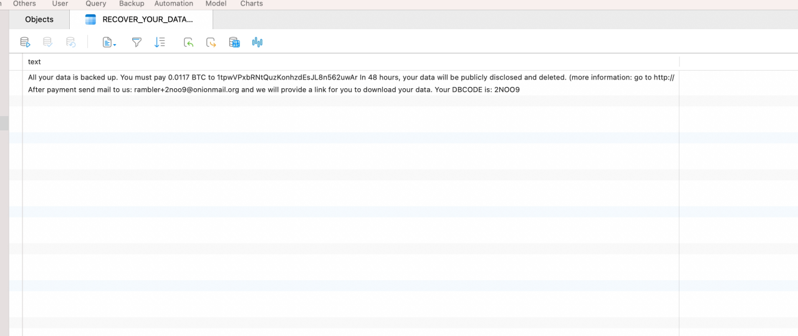

On March 20, 2024, I encountered a database extortion incident. The database had been cleared, and an English message claimed that all data had been backed up. It demanded 0.0117 BTC within 48 hours, threatening publication and deletion otherwise.

At the approximate exchange rate then, the demand was about RMB 5,500. The message alone could not establish whether the attacker actually held a recoverable copy.

*The extortion message left in the database at the time. It records the attacker's demands, but does not establish that they held a copy of the data.*

The incident raised a question: why demand bitcoin? How does a system without a bank keeping accounts determine who controls the money?

We can start with keys and records, then move to consensus, smart contracts and the limits of decentralization.

## 1. Starting with an extortion note

Bitcoin lets participants transfer value without obtaining a bank's approval for each transfer. Cross-border accessibility and addresses not directly naming real people have also made it a payment tool for some extortionists.

Its transactions are nevertheless public. Addresses can be connected to identities through transaction relationships, exchange records and other information. Bitcoin is not synonymous with complete anonymity or untraceable funds.

The payment demand touches a basic blockchain capability: maintaining verifiable asset records among strangers without a single bookkeeping institution.

Banks and their clearing systems maintain traditional accounts. Bitcoin gives nodes running its software the ability to validate records and uses a protocol to coordinate the accepted history.

Both systems require rules. The difference concerns who executes them and how much participants can verify independently.

## 2. What a private key controls

“Owning a bitcoin” can sound like holding a coin in a wallet. A wallet primarily manages keys, queries records and constructs and signs transactions.

Bitcoin uses unspent transaction outputs, or UTXOs. Earlier transactions leave outputs that have not yet been spent, each defining conditions for later spending. A wallet totals the outputs it can control to display a balance.

To transfer value, it selects spendable outputs, creates new outputs and signs using a private key. Nodes verify signatures and other conditions, checking authorization and attempts to spend already-used outputs.

For ordinary self-custody wallets, whoever controls the private key or seed phrase can generally authorize the relevant transfers. Software can be reinstalled, but there is usually no central support desk that can restore control after keys are lost.

A signature establishes authorization by the relevant key, not that the person understood the contents or that a recipient is trustworthy. Malicious sites can induce transfers or token approvals; an approved contract may spend tokens within its allowance. Key protection therefore needs to be accompanied by checking recipients, allowances and call contents.

An exchange account is different. Its displayed balance is usually a record in the platform's internal ledger, while the platform holds on-chain keys. Withdrawals depend on its actual assets, service availability and rules.

An asset being on-chain and a user personally controlling its key are separate facts. The first question is who can actually sign a transfer.

## 3. How unfamiliar nodes maintain one history

Copying a ledger across servers does not answer which history to accept when nodes receive conflicting transactions.

In Bitcoin, a transaction typically follows these steps:

1. A wallet constructs and signs it and submits it to network nodes.
2. Nodes validate it and relay it when it meets relay conditions.
3. Miners organize candidate transactions into a block and perform proof-of-work computation.
4. Other nodes independently validate the block and its transactions, then update their records under consensus rules.

Mining and validation are different responsibilities. Miners compete to produce blocks; nodes verify that blocks satisfy the rules they run. A block with substantial work is still rejected if it violates those rules.

When valid branches compete temporarily, nodes use cumulative work to select among valid chains. This is not a vote by a simple majority of servers. Adding servers does not automatically add equivalent consensus weight.

A transaction included in a block gains a confirmation. Subsequent blocks increase the work needed to replace that history. Confirmation is probabilistic; business systems choose confirmation counts according to value and risk, with more confirmations generally reducing reorganization risk.

Invalid transactions are rejected. A reorganization between valid branches can instead change confirmation status. These are different events and cannot both be described as the majority denying an action and making it disappear.

This also bounds hash-power attacks. A sufficiently powerful attacker may reorganize recent history, double-spend their own payments or censor transactions. Hash power alone cannot forge other people's signatures or make full nodes following the original rules accept arbitrary issuance. Transaction validity and history ordering provide distinct protections.

### Where mining income comes from

A valid block allows its miner to claim the block subsidy and included transaction fees through a special transaction.

The subsidy follows issuance rules: it began at 50 BTC and halves every 210,000 blocks. Nodes reject blocks claiming more than allowed.

This combines issuance and incentives. Miners bear equipment, electricity and opportunity costs; qualifying blocks receive rewards. Fees are the difference between transaction inputs and outputs, and miners generally consider fee levels and capacity when selecting transactions.

This describes Bitcoin proof of work. Other blockchains differ: Ethereum now uses proof of stake. Mining is not a universal mechanism for every blockchain.

## 4. How smart contracts execute rules

Bitcoin demonstrates verifiable transaction history. Platforms such as Ethereum also provide a general execution environment for on-chain applications.

A smart contract is code and state deployed at a particular address. Users submit transactions invoking its functions; the network executes the rules and incorporates the results into state.

Nodes must obtain consistent results from the same execution inputs. Ethereum contracts therefore cannot directly fetch arbitrary HTTP data like an ordinary backend. External facts need mechanisms such as oracles to bring them on-chain.

Execution is metered and limited by gas. Failed or reverted calls undo their associated state changes, but senders generally still pay for computation consumed. An outer contract can catch an internal call's failure and continue, so a failed subcall need not revert the entire transaction. A successful receipt likewise does not guarantee the economic outcome the user expected.

A token contract, for example, can track balances, transfers and allowances. Minting, pausing and freezing powers depend on its implementation and administration.

### Why one transaction can show several transfers

Consider this Polygon transaction, which shows three token-transfer events from one contract interaction.

*MATIC terminology and dollar estimates reflect the page at the time of the screenshot.*

The transaction involved multiple DAI transfers and an aToken event originating from the zero address. One business action can call multiple contracts and change several states, with explorers displaying the related events separately.

Token-transfer events and network fees describe different information. Fees have their own field. Token amounts need precision and conversion rules to interpret, rather than an assumption that different tokens have equal value.

Events help wallets, explorers and indexers present results. Verifying the business operation further requires contract addresses, code and actual state.

### Minting, burning and the zero address

Minting an ERC-20 token generally increases total supply and an address's balance. The standard recommends a `Transfer` event from the zero address when tokens are created.

Common implementations reduce supply on burns and emit events to the zero address. OpenZeppelin explicitly distinguishes ordinary transfers, minting and burning in its balance and supply logic.

The zero address is a special marker here. An explorer display alone does not prove supply changed: contracts can emit events without corresponding state changes, and sending assets to an inaccessible address does not necessarily reduce recorded total supply. Inspect the actual logic.

Deploying a token establishes accounting and transfer rules, not lasting demand or value. Liquidity improves trading conditions but does not guarantee durable value, and scarcity alone does not explain price.

## 5. Where trust remains after decentralization

Applications also involve custodians, websites, data services and real assets. A ledger's properties do not automatically describe the whole application.

### Centralized exchanges rely on internal accounts

Exchanges usually match trades and update balances internally, interacting with the chain for deposits and withdrawals. A trade within a platform need not produce a corresponding on-chain transfer.

This supports low-latency matching and complex trading but concentrates custody, bookkeeping and withdrawal obligations. Seeing some platform assets on-chain does not independently establish all customer liabilities or internal records.

Blockchain assets and centralized operation are compatible. Custody risk depends on control and internal business mechanisms as well as chain records.

### Stablecoins extend trust off-chain

Issuer-managed stablecoins such as USDT connect tokens to conventional finance. Their transfer rules must be distinguished from reserves, issuance and redemption arrangements.

A contract cannot independently ensure that a bank received dollars or prove reserves sufficient and liquid. Reserves can contain different assets and should be checked against disclosures rather than assumed to be matching bank cash.

A market price near one dollar also differs from every holder being able to redeem directly at any moment. Eligibility, terms and operating conditions apply, while secondary prices reflect liquidity and expectations.

Stablecoins provide a familiar unit of account while retaining reliance on issuers and off-chain institutions.

### Public code does not remove administrative control

Contracts may expose upgrade, pause or mint powers. If a small number of keys controls them, users still depend on administrators and key security.

Check whether published source corresponds to deployed bytecode and whether an upgradeable proxy controls the current implementation. Verified source enables inspection; it is not a security audit or proof of no vulnerabilities. Token approvals, proxy upgrades and administrative keys belong in the review alongside business logic.

Contracts needing real-world prices or other external facts also rely on oracles. Programs execute the supplied data, but its accuracy and timeliness have their own trust and failure boundaries.

For a particular application, I ask:

| Question | Meaning for users |
| --- | --- |
| Who holds keys and signs transfers? | Direct control versus dependence on a custodian. |
| Who can upgrade, pause or change parameters? | Who can alter current rules and what approval is required. |
| Which off-chain assets and data are needed? | What is independently verifiable and what depends on external claims. |
| Can users verify and exit independently? | Whether assets remain accessible if a website or provider fails. |

Decentralization can apply separately to bookkeeping, verification, custody, governance and entry points. Evaluating these individually is more useful than asking only whether blockchain is used.

## Rules, costs and suitable uses

As a developer, I look for collaboration problems where several parties maintain shared records but do not want one of them to have final control. Independently verifiable records and rules can help.

They also impose costs: consensus constrains throughput and adds waiting; public records complicate privacy; key loss and contract defects may have irreversible consequences. A single organization with clear authority may be better served by databases, audit logs and backups.

For sensitive data such as medical reports, lasting public verifiability can conflict with confidentiality, deletion and access control. Hashing contents does not automatically solve privacy: guessable data can be enumerated and compared, while metadata may expose relationships. Evidence designs must address original storage, key management, associations and verification permissions separately from the decision to use a chain.

Returning to the extortion incident, blockchain can be the payment mechanism, but database access control and recovery still belong to the original system. Decentralizing one component does not complete the security of the rest.

The art is arranging control and verification explicitly: what rules guarantee, what institutions still provide, and who bears failures. Understanding those boundaries makes it possible to judge the problem solved and whether the costs are justified.

## References

For details on the mechanisms discussed in this article, see:

- [Bitcoin Core: validation, cumulative-work selection and subsidies](https://github.com/bitcoin/bitcoin/blob/master/src/validation.cpp)
- [Ethereum: smart contracts](https://ethereum.org/en/developers/docs/smart-contracts/)
- [Ethereum: transactions, gas and execution outcomes](https://ethereum.org/en/developers/docs/transactions/)
- [ERC-20: token interfaces and Transfer events](https://eips.ethereum.org/EIPS/eip-20)
- [OpenZeppelin: transfers, minting and burning](https://github.com/OpenZeppelin/openzeppelin-contracts/blob/master/contracts/token/ERC20/ERC20.sol)

Stablecoin arrangements change. See [Tether reserve disclosures](https://tether.to/en/transparency/) and [terms](https://tether.to/en/legal/) for applicable issuer information and conditions.
